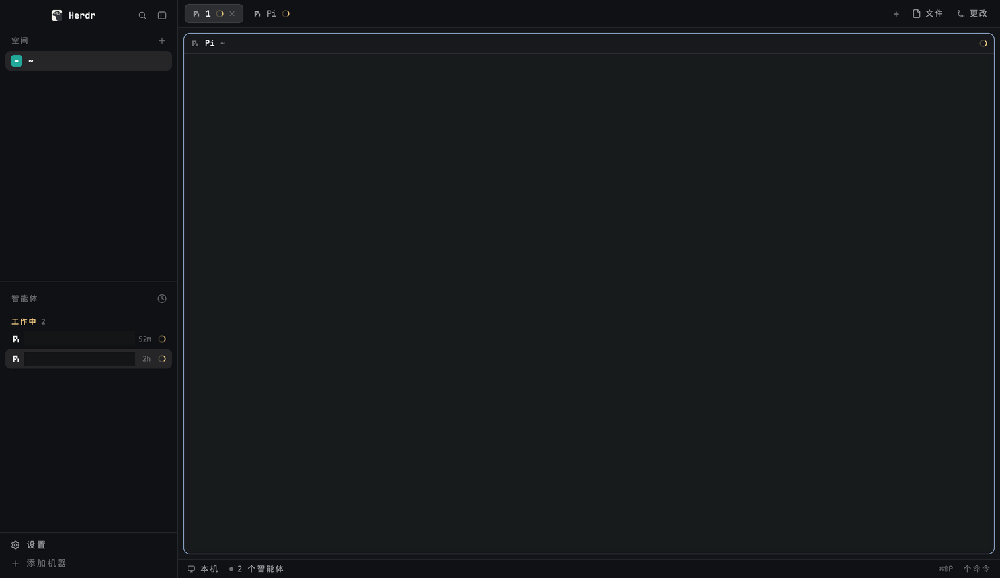

# Herdr 中文工作台

保留 Herdr 原版主布局，将空间、智能体、标签、文件、更改和常用菜单改为中文。同一仓库提供内置页面的中文补丁及维护工具，可从设置、欢迎页等页面继续补充翻译。



这是社区维护的中文定制包，基于 **Herdr 0.1.15**，不是官方语言包。布局按 [Herdr 官方分享格式](https://herdr.dev/layouts)组织；内置页面汉化是额外的源码文案补丁，不会仅因安装布局而自动启用。

## 从哪里开始

- **使用中文主界面**：阅读下面的“安装布局”，以及 [RECIPE.md](RECIPE.md) 的布局与模块说明。
- **继续汉化设置等内置页面**：从 [RECIPE.md 的中文维护入口](RECIPE.md#中文维护入口内置页面)开始，修改 `translations/frame/` 中对应页面的规则。
- **维护模块文案**：只修改 `translations/dict.js`，运行 `python3 manage.py build` 同步各模块的 `i18n.js`。
- **查看实际验证范围**：阅读 [VALIDATION.md](VALIDATION.md)。未宣称所有动态状态和原生弹窗都已完全汉化。

## 安装布局

先安装并启动 Herdr，再取得本仓库：

```sh
git clone https://github.com/ssdiwu/herdr-zh.git
cd herdr-zh
```

可以把下面这段话交给你的智能体，按官方布局安装流程处理：

> 读取本机 `~/.config/herdr-app/AGENTS.md`、本仓库的 `RECIPE.md` 和全部待安装文件，将中文布局及依赖模块加入 Herdr。保留原有布局和配置；有同名文件时统一更名并更新引用。快捷键冲突先说明再处理。安装后逐个运行 `herdr-app check`，再切换到中文布局。内置页面汉化另按 README 的可选流程处理，不自动启用个人预设。

本包的文件与更改面板会读取工作目录、执行 git；工作树菜单可创建或删除工作树；添加机器模块沿用 hc / ssh 连接流程。这些是原版模块保留的能力。

也可以使用保守安装工具，需要 **Python 3.9+、macOS 和可从命令行访问的 `herdr-app`**：

```sh
# 预览计划；有冲突时会停止
python3 manage.py install --dry-run
python3 manage.py install
herdr-app do layout.switch '{"name":"zh"}'
```

工具会合并最小快捷键 `Cmd+P` → 中文选择器。原有 `Cmd+P` 已绑定其他动作、或存在未纳管的同名文件时，工具拒绝覆盖。请核对并解决冲突，或让智能体按上面的官方流程更名安装；不要为绕过冲突临时生成基准清单。

如果修改了布局名、模块名或快捷键，后续命令也应使用实际名称。终端、空间和窗口状态不随本包分发。

## 可选：内置页面汉化

页面补丁位于 `translations/frame/`：

| 规则文件 | 页面 |
|---|---|
| `settings.json` | 设置 |
| `palette.json` | 命令面板 |
| `welcome.json` | 欢迎页 |
| `feedback.json` | 反馈页 |
| `whatsnew.json` | 更新介绍 |

布局和模块安装完成后，在仓库目录执行：

```sh
# 检查词典同步与内置页面规则；--native 另检查 20 个模块
python3 manage.py check --native
# 单独应用内置页面补丁
python3 manage.py patch
# 后续同时更新布局、模块和页面补丁
python3 manage.py install --frames
```

默认应用目录为 `~/.config/herdr-app`；其他目录用 `--app-home /绝对路径`。工具核验过的版本是 `0.1.15`；版本变化或规则失配时停止并报告，应先核对上游变化，再调整规则和版本约束。

Herdr 会在启动时重写 `frame/`。需要持续补汉化时，可运行：

```sh
python3 manage.py watch
```

该命令在前台持续运行，退出后停止监听；它不会自动注册后台服务。需要开机启动时，按自己的系统管理方式运行这一命令，并使用 Python、仓库和应用目录的绝对路径。监听启动时先检查一次，之后在页面被重写时再次应用补丁；进程锁防止重复监听实例。

不要只编辑生成的 `frame/<页面>/main.js`：持久维护源是本仓库中的规则文件。具体流程见 [中文维护入口](RECIPE.md#中文维护入口内置页面)。

## 个人预设与回退

`presets/507-settings.json` 与 `presets/507-keys.json` 保存一套可选偏好，包括 Maple Mono Normal NF CN 字体、终端字号 12，以及声音、使用数据和快捷键设置。默认安装不启用；字体需要自行安装或改为已有字体。明确采用后才添加 `--personal`：

```sh
python3 manage.py install --frames --personal
```

安装只覆盖本包上次安装后未被另行修改的文件；已有值冲突时停止。其他未声明的配置键保留。`--baseline` 仅用于有完整备份、已核对差异的旧定制接管，不是强制覆盖选项。

每次实际安装或 `patch` 写入前，会备份变更文件并输出 `.herdr-zh/backups/<时间>/receipt.json` 回执。回退时指定该回执：

```sh
python3 manage.py rollback --receipt /绝对路径/receipt.json
```

先停止正在运行的补丁监听，再回退。回退会检查全部文件及备份内容；存在安装后修改时停止，不覆盖后续工作。回退恢复的是该次操作前的文件，不等于卸载全部历史定制。应用会话和终端数据不在安装或回退范围内。

## 文件与已知边界

`layouts/` 和 `mods/` 是官方格式的布局及模块；`RECIPE.md` 是重建说明；`preview.png` 来自真实窗口，终端内容和本地会话标签已遮盖。`manage.py` 负责生成、检查、安装、页面补丁、监听和回退。

- 本包保留 20 个中文模块；每个模块的 `i18n.js` 是生成副本，不单独维护。
- 部分原生入口固定使用原版模块，不能因为存在 `help-zh`、`confirm-zh`、`prompt-zh`、`toast-zh`、`peek-zh` 就声称这些入口都已中文化。
- `terminals-bar-zh`、`terminals-pane-zh` 是备用模块，默认中文主布局不引用。
- 远端返回的错误、程序输出、部分动态文案可能仍是英文。
- 原生初始检查不覆盖所有异步状态、交互及远程机器操作。实际应用重启后的全量重建尚未端到端验收，监听恢复已在隔离目录验证。
- 管理脚本使用 Unix 文件锁，当前验证环境为 macOS；不声称管理工具兼容 Windows。
- 升级 Herdr 后先比较官方文件，不直接放宽版本检查。克隆模块不会自动继承上游新功能。

## 来源与许可

布局和模块基于 [herdrdev/herdr-app v0.1.15](https://github.com/herdrdev/herdr-app/tree/v0.1.15)。代码按 [Apache-2.0](LICENSE) 分发，图标保留 [Lucide / Feather 许可](licenses/LICENSE-Lucide.txt)。修改内容和来源见 [NOTICE.md](NOTICE.md)。

仓库包含官方要求的布局、模块、重建说明和预览。GitHub 主题标签为 `herdr-layout`；是否以及何时出现在官方社区目录，以官网实际收录结果为准。
