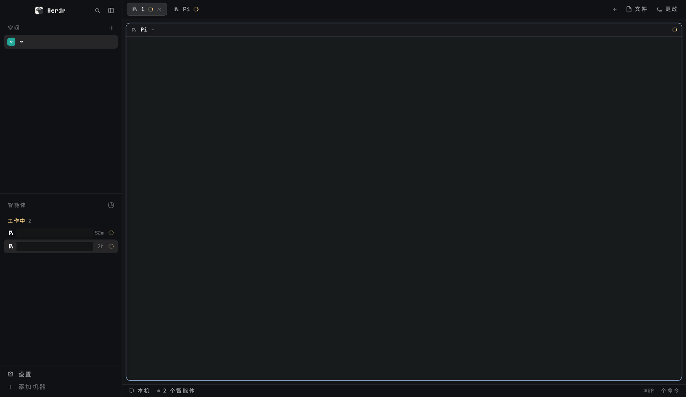

# Herdr 中文工作台

保留 Herdr 原版主布局，把空间、智能体、标签、文件、更改和常用菜单改为中文。真实终端继续运行在中央，颜色跟随当前 Herdr 主题；个人字体和快捷键以可选预设保存。设置等内置页面可以通过附带的独立补丁汉化。

## 看到什么

左侧栏宽 268，顶部 46 高显示 Herdr 标识、搜索与收起按钮；中部空间和智能体各占一份剩余高度，最小高度各 90；底部 69 高显示设置和添加机器。侧栏收起后由原有模块显示紧凑图标。

右侧顶部标签栏高 42。工作区内边距和面板间距为 8，终端卡片圆角 10，边框 1，聚焦时采用主题 accent 色。终端标题栏高 30，终端内边距为横向 14、纵向 12。右侧文件和更改面板初始隐藏，默认宽 368，允许 280–900。底部状态栏高 28，显示本机、智能体数与命令入口。

背景分别使用 canvas、chrome、background，文字使用 foreground、muted、dim。没有固定配色，也不重写主题。当前个人预设为 Maple Mono Normal NF CN，终端字号 12；该字体不是布局依赖。

## 如何操作

空间、标签、终端、文件与更改面板沿 Herdr 原版行为。点击空间和标签切换当前工作；标签右键打开中文菜单，加号打开启动终端、智能体或工作树的菜单；文件和更改按钮控制右侧面板。终端标题栏提供拆分、缩放和关闭操作。空间可拖动排序，布局保留原版拖动与折叠行为。

智能体状态遵循原版：working 使用旋转指示，blocked 显示“需要你处理”，done 表示用户未查看的完成状态，idle 表示空闲。列表支持优先级和按空间分组，以及置顶。选择智能体沿 `agent.focus` 等官方命令进入其终端；状态排序语义不改。

`Cmd+P` 打开中文选择器；侧栏搜索也打开它。添加机器显式打开 `machine-add-zh`，通过已有 ssh 与 herdr-core 流程连接。菜单文字、占位符和提示翻译为中文，不翻译机器名、文件名、分支名、程序名或命令标识。

## 构成

`layouts/zh.json` 克隆自 Herdr 0.1.15 的 `main`。根为横向排列：左侧 sidebar 列、右侧 work 列。sidebar 包含 brand、sidebar-lists、sidebar-footer；work 包含 tabs、work-body、status；work-body 包含 active tab 与默认隐藏的 panel。

直接模块：`workspace-chrome-zh`（顶部与 footer 两种 props）、`spaces-zh`、`agents-zh`、`tabs-zh`、`pane-zh`、`files-zh`、`changes-zh`、`workspace-status-zh`。

显式打开的模块：`menu-zh`、`new-menu-zh`、`picker-zh`、`worktree-zh`、`machine-add-zh`。保留原有备用中文副本：`help-zh`、`confirm-zh`、`prompt-zh`、`toast-zh`、`peek-zh`、`terminals-bar-zh`、`terminals-pane-zh`；不据此声称原生入口都会调用它们。

各模块使用原生 gpui-kit / gpui-base，不使用网页。通过 `spaces()`、`agents()`、`panes()`、`terminals()` 读取状态，通过 `run`、`openOverlay`、`closeOverlay` 执行导航和弹窗，通过 `shared` 维持原有布局交互状态。使用上游图标，以及应用随附的 `icons/` 和欢迎页 Herdr 标识；需要完整安装 Herdr。

这些不是纯静态主题：文件和更改模块读取工作目录并执行原版 git 操作；提交按钮执行 git commit；工作树模块执行 git worktree 操作；添加机器模块通过 hc / ssh 管理机器。文件读取、外部程序及远程访问能力来自保留的原版模块，汉化未额外添加远程服务。

唯一词典在 `translations/dict.js`，`manage.py build` 将其投影到每个模块的 `i18n.js`。内置页面补丁按页面放在 `translations/frame/`，属于额外兼容机制，不属于官方布局替换接口。

## 中文维护入口：内置页面

本仓库可以同时分发布局和内置页面补丁，但安装布局不会自动启用页面补丁。继续汉化时，先阅读本机 `~/.config/herdr-app/AGENTS.md`，再从下面对应文件开始：

| 页面 | 本仓库维护源 | 本机对照文件 |
|---|---|---|
| 设置 | `translations/frame/settings.json` | `frame/settings/main.js` |
| 命令面板 | `translations/frame/palette.json` | `frame/palette/main.js` |
| 欢迎页 | `translations/frame/welcome.json` | `frame/welcome/main.js` |
| 反馈页 | `translations/frame/feedback.json` | `frame/feedback/main.js` |
| 更新介绍 | `translations/frame/whatsnew.json` | `frame/whatsnew/main.js` |

本机对照文件相对于 Herdr 应用目录。每条规则使用 `from` 和 `to` 指定源码片段；对照真实源码选择展示文案，不改变命令名、状态键、用户输入或动态插值。先用 `python3 manage.py check` 检查规则，再用 `python3 manage.py patch` 应用，最后检查实际页面和 `herdr-app status`。改动页面代码后还应对相应页面运行 `herdr-app check`；这些检查不能替代真实交互验收。

应用启动时会重新生成 `frame/`，因此持久修改应落在本仓库的规则中。`python3 manage.py watch` 可在运行期间持续补汉化；后台启动方式由安装者配置，标准布局安装流程不会自动注册服务。备份和回退方法见 [README.md](README.md#个人预设与回退)。

目前核验的是 Herdr `0.1.15`。内置页面补丁属于社区兼容方案，不是官方语言接口。遇到新版，先比较源码与规则并完成验证，再更新版本约束；不要直接将版本检查改为放行所有版本。

## 重建注意

先读取本机自动生成的 `AGENTS.md` 与类型文件。从原版克隆布局和模块，保留命令、状态键和动态值，只翻译展示文案并连接对应中文模块。重名时按官方要求统一更名，不能覆盖别人的模块。

不要让模板自带会话、终端地址、窗口位置、共享状态或工作目录。不要写回应用自动生成的 AGENTS.md 或类型文件。个人偏好以合并方式处理，不用整份配置覆盖用户设置。

字符串替换必须与当前真实源码匹配。已有坑包括把 row 参数误写成 `.child(...)`、把反引号模板串写成普通字符串，以及词典里有完整模板但调用只传半句。失配必须报告，不能视作成功。

应用启动会重写 frame 文件，因此内置页面补丁需要再次应用；监听需要单实例、版本约束和失败提示。不能仅修改 frame 文件后就声称永久生效。布局副本不会自动继承上游新功能，升级必须重新核对。

预览使用真实窗口截屏，终端内容和本地会话标识会遮盖；不包含可运行的示例会话。该处理只用于分享预览，不改变应用。

## 完成条件

1. 20 个中文模块分别通过 `herdr-app check`，运行窗口 `status` 没有新增错误。
2. 切到 zh 布局后，空间、智能体、标签和状态栏显示中文，原布局尺寸与终端仍保持。
3. 侧栏“添加机器”打开中文模块，搜索打开中文选择器。
4. 可选内置页面补丁的全部规则匹配；提醒页“播放声音”、说明和默认声音名称为中文；原生初始页面检查通过。
5. 同一安装重复执行不产生写入；遇到同名未纳管文件或快捷键冲突停止。
6. 回退恢复该次安装前字节；存在后续修改或损坏备份时停止，不覆盖它们。
7. 监听重新应用当前版本页面补丁，第二个监听实例不能取得锁。升级后先核对兼容性。

以上是重建与验收要求，实际执行证据的摘要与未覆盖范围见 [VALIDATION.md](VALIDATION.md)。
